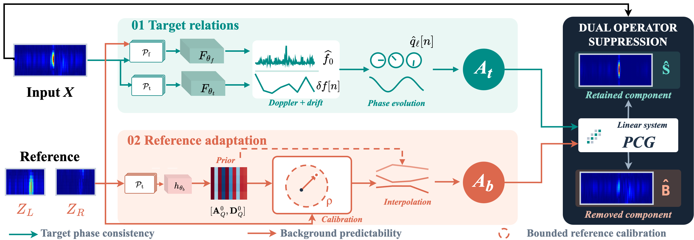
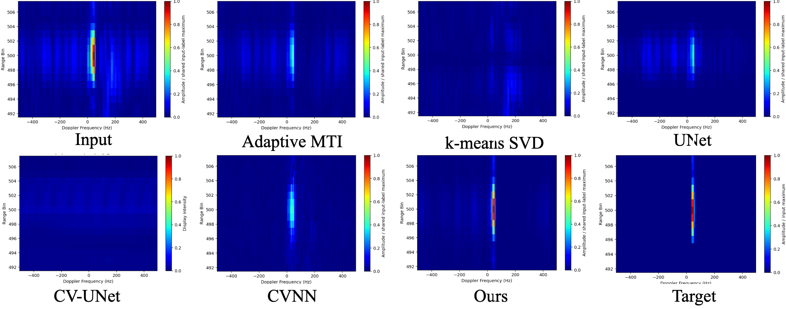

# RG-SCS

**Relation-Guided Sea Clutter Suppression with Joint Target and Background Constraints**

RG-SCS estimates target phase evolution from complex radar echoes and learns clutter dynamics from neighboring range cells. A preconditioned conjugate gradient solver uses both constraints to recover the target echo.



## Results on measured echoes

| Input | RG-SCS output |
| :---: | :---: |
|  |  |

Both panels use the same amplitude scale. The comparison below shows the same echo processed by five baselines and RG-SCS (labeled *Ours*).



## Quick start

From the repository root, install the dependencies with Python 3.11.

```bash
python -m venv .venv
source .venv/bin/activate
python -m pip install -r requirements.txt
```

[Download the example ZIP](https://github.com/miraclebai/RG-SCS/releases/download/example-files/rg-scs-example.zip)

```bash
unzip rg-scs-example.zip
python method/infer.py --checkpoint best.pt --input real_20221113070041_stare_HH_p000512_r0492.npz --first-range-bin 492 --output-dir inference/measured
```

The command writes the complex target estimate and two range–Doppler plots with a shared amplitude scale to `inference/measured/`.

## Train on the full dataset

Set `DATA_ROOT` to the directory containing [reports/manifest.csv](reports/manifest.csv) and the NPZ files at the paths listed in it. Each sample stores normalized complex IQ arrays in **(pulses, range cells)** order. The input `x` has shape `(256, 16)`; `refs_left` and `refs_right` each have shape `(256, 8)`. The supervised target `s` and background `b` both match `x`. Synthetic examples provide target IQ and phase labels. Background-only examples use a zero target. The loader extracts `b` from the center 16 cells of `background_raw` and divides by the sample scale.

Supply the original NPZ data for this run. The commands below train from scratch and evaluate the resulting checkpoint.

```bash
DATA_ROOT=/path/to/data-root
python method/train.py --data-root "$DATA_ROOT" --epochs 250 --batch-size 768 --device cuda --run-dir runs/full --skip-inference
python method/infer.py --data-root "$DATA_ROOT" --run-dir runs/full --tag best --device cuda --output-dir inference/full
```

Training reads the `train` split. Add `--resume` to the same command to continue an interrupted run. Inference reads the `test` split and loads `best.pt` or `last.pt` from the run directory. Fresh runs use cosine decay; the experiment shown above used a fixed learning rate after epoch 85.
