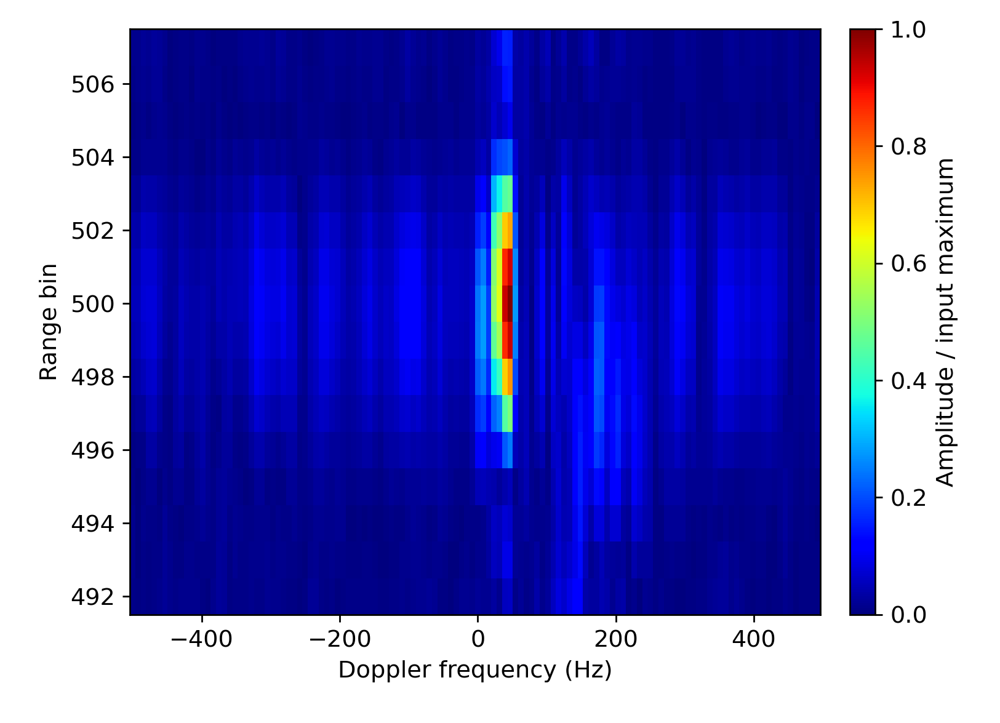
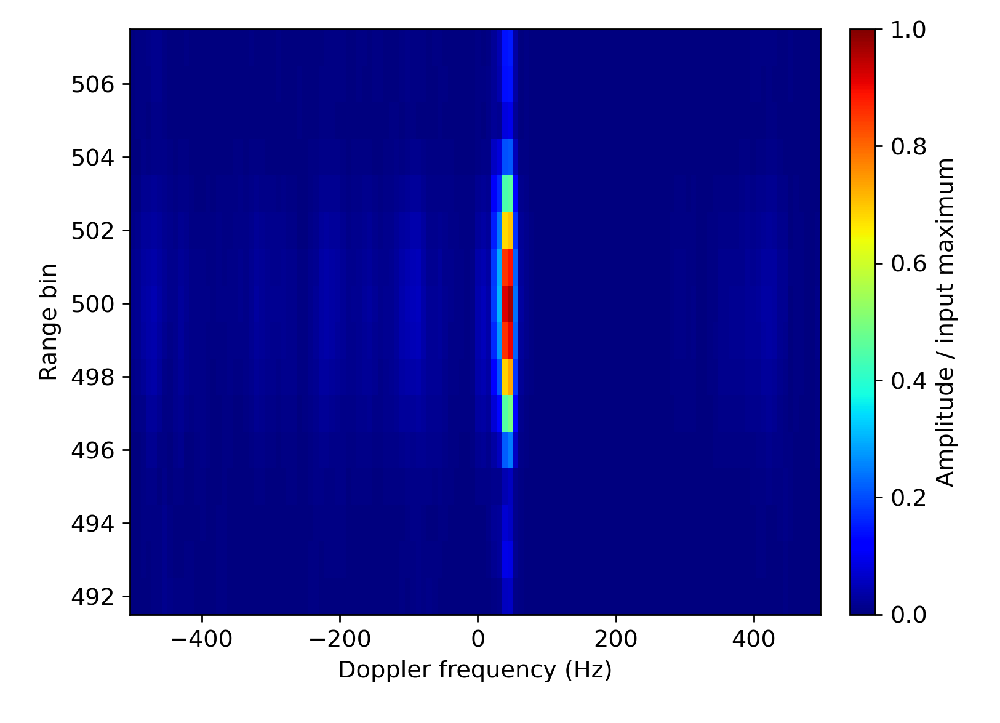

# RG-SCS

**Relation-Guided Sea Clutter Suppression with Joint Target and Background Constraints**

RG-SCS estimates target phase evolution from complex radar echoes and learns clutter dynamics from neighboring range cells. A preconditioned conjugate gradient solver uses both constraints to recover the target echo.


## Results on measured echoes

| Input | RG-SCS output |
| :---: | :---: |
|  |  |

Both panels use the same amplitude scale. The comparison below shows the same echo processed by five baselines and RG-SCS (labeled *Ours*).


## Run on CPU

From the repository root, use Python 3.11 and install the dependencies.

```bash
python -m venv .venv
source .venv/bin/activate
python -m pip install -r requirements.txt
python method/check_forward.py
```

Generate two synthetic training examples and one test example, train for one epoch, then run inference with the saved checkpoint.

```bash
python examples/make_demo.py --output demo-data
python method/train.py --data-root demo-data --epochs 1 --batch-size 2 --device cpu --num-workers 0 --run-dir runs/demo --skip-inference
python method/infer.py --data-root demo-data --run-dir runs/demo --tag last --device cpu --output-dir inference/demo
```

The demo writes a range–Doppler plot and per-sample metrics to `inference/demo/last/`. The measured results above come from the full experiment.

## Train on the full dataset

Set `DATA_ROOT` to the directory containing [reports/manifest.csv](reports/manifest.csv) and the NPZ files at the paths listed in it. Supply the original NPZ data for this run. Training writes the weights used by the inference command.

```bash
DATA_ROOT=/path/to/data-root
python method/train.py --data-root "$DATA_ROOT" --epochs 250 --batch-size 768 --device cuda --run-dir runs/full --skip-inference
python method/infer.py --data-root "$DATA_ROOT" --run-dir runs/full --tag best --device cuda --output-dir inference/full
```

Training reads the `train` split. Add `--resume` to the same command to continue an interrupted run. Inference reads the `test` split and loads `best.pt` or `last.pt` from the run directory. Best-checkpoint selection begins at epoch 21. Fresh runs use cosine decay; the experiment shown above used a fixed learning rate after epoch 85.
